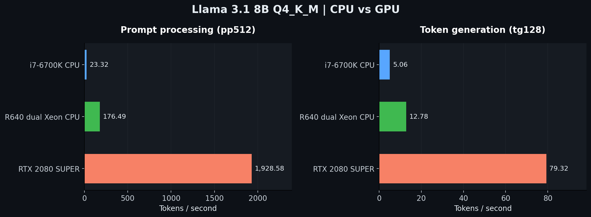
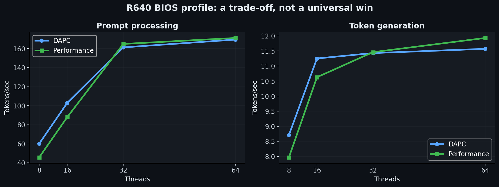
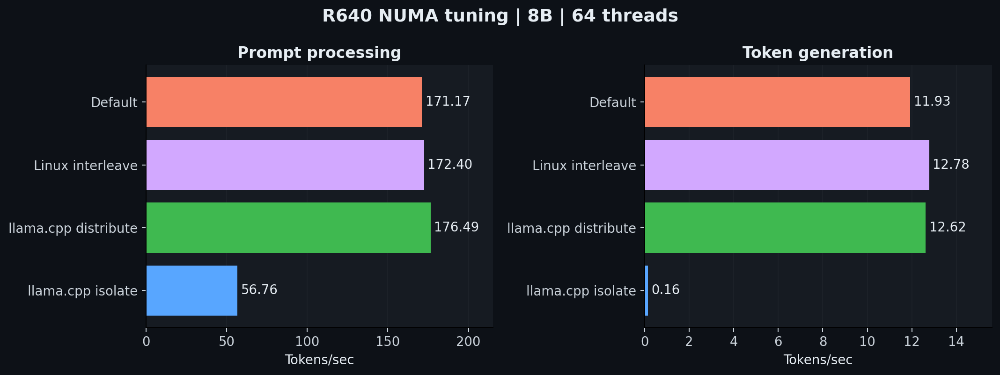
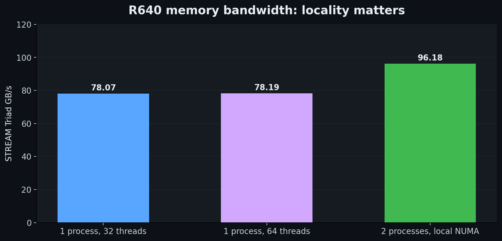
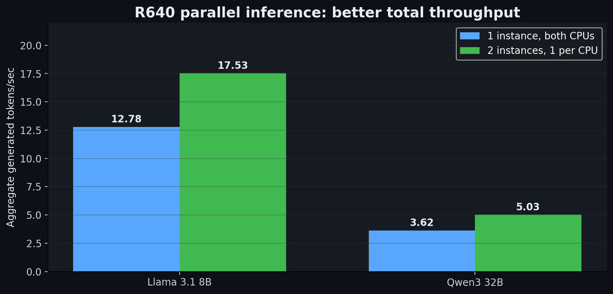

# Dell PowerEdge R640 vs i7-6700K / RTX 2080 SUPER — Local LLM Benchmarks

   

> **Can a refurbished dual-Xeon enterprise server make a good local AI machine?** This case study reports real CPU-only and GPU inference benchmarks, BIOS and NUMA tuning, STREAM memory measurements, and concurrent inference tests.

## TL;DR

- **For interactive 8B LLMs, the GPU wins decisively.** The RTX 2080 SUPER generated **79.32 t/s**, vs. **12.78 t/s** on the best measured R640 CPU configuration and **5.06 t/s** on the i7 CPU.
- **For CPU-only performance, the R640 wins:** best measured 8B prompt processing **176.49 t/s** versus **23.32 t/s** on the i7, a **7.57×** speedup; 8B generation was **2.53×** faster.
- **For larger models**, the R640's **256 GB RAM** accommodates a 32B Q4 model without GPU VRAM limitations, but generated only **3.62 t/s** with one instance.
- **For parallel CPU inference**, two independent NUMA-local instances improved aggregate generation by **37% (8B)** and **39% (32B)**, *not* single-user response speed.
- **NUMA tuning matters**; power profile changes were not uniformly beneficial. More cores and threads alone did not solve memory-limited generation.



## Test hardware

| | Dell PowerEdge R640 | HP Omen |
|---|---|---|
| CPU | 2 × Intel Xeon Gold 6142 (Skylake-SP) | Intel Core i7-6700K (Skylake) |
| Cores / threads | 32 / 64 total | 4 / 8 |
| Base / max turbo | 2.6 / 3.7 GHz | 4.0 / 4.2 GHz |
| RAM | 256 GB ECC DDR4-2400 (8 × 32 GB) | 32 GB DDR4 |
| DIMM placement | A1, A2, A4, A5; B1, B2, B4, B5 | Not recorded |
| Populated channels | 4 per CPU, 8 total | Not verified |
| NUMA | 2 nodes, ~128 GB/node | Single socket |
| GPU | None used | NVIDIA GeForce RTX 2080 SUPER, 8 GB VRAM |
| OS | Debian Linux | Ubuntu-based Linux |

The R640's theoretical peak aggregate bandwidth with **eight DDR4-2400 channels** is **153.6 GB/s** (not an observed STREAM rate). Its Xeons support AVX-512; the i7-6700K does not. The GPU test used NVIDIA driver 595.84 and CUDA toolkit 12.0.

## Methodology

- `llama.cpp` Git revision **`f2cc7282c`**, build **11559**, on both hosts; native CPU builds, separate CUDA build on Omen.
- **8B**: Meta Llama 3.1 8B Instruct Q4_K_M, **4.58 GiB** GGUF; **32B**: Qwen3-32B Q4_K_M, **18.40 GiB** GGUF.
- `llama-bench -p 512 -n 128 -r 3`, except a one-repeat monitoring pass. **`pp512`** measures prompt processing and **`tg128`** measures generation, in tokens/sec. Larger = faster.
- CPU runs used `-ngl 0`; RTX 2080 SUPER CUDA run used `-ngl 99` and 4 CPU threads.
- Runs weren't a formal statistical performance study: BIOS configurations were not repeatedly alternated, background workload control was limited, and optimal thread settings may vary. The charts show measured results, not guaranteed general performance.
- Best-of-different-configuration comparisons combine maxima from separate runs. The `pp` and `tg` maxima need **not** occur under the same settings.

## 1. Baseline: 8B CPU-only

### i7-6700K

| CPU threads | pp512 (t/s) | tg128 (t/s) |
|---:|---:|---:|
| 1 | 6.28 | 2.29 |
| 2 | 12.61 | 4.05 |
| 4 | 22.66 | **5.06** |
| 8 | **23.32** | 4.67 |

Hyper-Threading improved `pp512` slightly at eight threads, **but reduced generation** versus four physical-core threads.

### R640, original DAPC BIOS profile

| CPU threads | pp512 (t/s) | tg128 (t/s) |
|---:|---:|---:|
| 8 | 60.14 | 8.71 |
| 16 | 102.97 | 11.25 |
| 32 | 161.29 | 11.43 |
| 64 | **169.48** | **11.57** |

More threads helped prompt processing considerably, but generation nearly plateaued after 16 threads.

## 2. BIOS Performance profile: mixed results

After documenting iDRAC settings, the R640 System Profile was changed from **Performance Per Watt (DAPC)** to **Performance**. This also changed associated power management, C-state, and uncore frequency settings. Memory remained at DDR4-2400; Turbo Boost remained enabled.



| Threads | DAPC pp512 | Performance pp512 | DAPC tg128 | Performance tg128 |
|---:|---:|---:|---:|---:|
| 8 | 60.14 | 45.75 | 8.71 | 7.97 |
| 16 | 102.97 | 88.02 | 11.25 | 10.63 |
| 32 | 161.29 | 164.92 | 11.43 | 11.46 |
| 64 | 169.48 | 171.17 | 11.57 | 11.93 |

**Takeaway:** The nominally fastest BIOS profile did **not** help all workloads. It was markedly worse at 8–16 threads, slightly better at 32–64. Results call for confirmation with repeated runs. No blanket BIOS reset is recommended without recording boot and storage settings.

## 3. NUMA experiments: memory placement can help or hurt

Each R640 CPU has ~128 GB local RAM. Linux reported relative NUMA distance **10 local / 21 remote**; these are topology costs, *not* measured latency multipliers.



| R640 8B, Performance profile, 64 threads | pp512 | tg128 |
|---|---:|---:|
| Default placement | 171.17 | 11.93 |
| `numactl --interleave=0,1` | 172.40 | **12.78** |
| `--numa distribute` | **176.49** | 12.62 |
| `--numa isolate` | 56.76 | **0.16** |

Linux interleaving increased generation by **7.1%** relative to the default Performance-profile run. The extreme regression with `isolate` is a *pathological observed result*, not a general claim that isolate must always be slow; its cause was not diagnosed.

Another test binding one 16-thread instance to node 0 (`--cpunodebind=0 --membind=0`) yielded **89.58 pp / 10.29 tg**, versus unpinned 16-thread **88.02 pp / 10.63 tg**.

Example command:

```bash
numactl --interleave=0,1 \
  ./build/bin/llama-bench \
  -m models/Meta-Llama-3.1-8B-Instruct-Q4_K_M.gguf \
  -t 64 -p 512 -n 128 -ngl 0 -r 3
```

## 4. RTX 2080 SUPER: GPU acceleration dominates 8B

| Device and best observed configuration | pp512 | tg128 |
|---|---:|---:|
| i7-6700K CPU | 23.32 | 5.06 |
| Dual Gold 6142 R640 CPU | 176.49 | 12.78 |
| **RTX 2080 SUPER CUDA** | **1,928.58** | **79.32** |

The RTX 2080 SUPER was **10.9× faster** than the R640's best CPU prompt rate and **6.2× faster** than its best CPU generation rate. Compared with the i7 CPU, it was **82.7×** and **15.7×** faster, respectively.

This 8B Q4_K_M model fit in the 8 GB GPU VRAM. The RTX 2080 SUPER result **does not imply** the same performance for larger models needing CPU/GPU split offload.

CUDA benchmark example:

```bash
./build-cuda/bin/llama-bench \
  -m models/Meta-Llama-3.1-8B-Instruct-Q4_K_M.gguf \
  -t 4 -p 512 -n 128 -ngl 99 -r 3
```

## 5. Qwen3-32B: R640 runs a larger model, but slowly

| R640 32B Q4_K_M, interleaved | pp512 | tg128 |
|---|---:|---:|
| 32 threads | 36.73 | 3.48 |
| 64 threads | **37.89** | **3.62** |
| 64 threads, monitoring rerun (`-r 1`) | 37.33 | 3.59 |

A 200-token answer at 3.62 t/s takes **~55 seconds for generation alone**. Qwen3 thinking modes can add generated tokens. Capacity is not the same thing as responsiveness.

## 6. CPU clocks, thermals, and package power under 32B

Using `turbostat` during a monitored Qwen3-32B run:

| Observation | Recorded value |
|---|---|
| Utilization during busy phases | ~99–100% |
| Lower busy frequency phase | ~2.35 GHz |
| Higher busy frequency phase | ~3.08 GHz |
| Highest observed package temperature | ~74 °C |
| Aggregate reported CPU package power under load | ~230–240 W |

No *obvious* thermal throttling was seen, but power-limit and thermal-limit telemetry were not captured comprehensively. The 2.35/3.08 GHz transition was not timestamp-aligned to individual benchmark phases, so assigning each clock range definitively to prompt or generation would be speculative. `PkgWatt` is **not whole-server wall power**.

## 7. STREAM: memory bandwidth and NUMA locality

STREAM 5.10 was compiled with GCC 14.2.0 (`-O3 -march=native -fopenmp`), using **80,000,000 doubles per array**, three arrays (~1.8 GiB total) and 20 iterations. Each value below is STREAM's best reported bandwidth, converted from decimal MB/s to GB/s.

| STREAM operation | Both CPUs, 32 threads | Both CPUs, 64 threads |
|---|---:|---:|
| Copy | 73.81 | 74.98 |
| Scale | 68.78 | 67.88 |
| Add | 78.00 | 77.94 |
| **Triad** | **78.07** | **78.19** |

The Triad throughput hardly changed between 32 and 64 threads. The next test pinned each 16-thread process to one NUMA node and its *local* memory:

| Operation | Node 0 alone | Node 1 alone |
|---|---:|---:|
| Copy | 53.77 | 53.87 |
| Scale | 42.49 | 42.57 |
| Add | 47.92 | 47.98 |
| Triad | **48.01** | **48.11** |

Two **simultaneous** local STREAM processes reported:

| Operation | Node 0 | Node 1 | Sum of rates |
|---|---:|---:|---:|
| Copy | 54.15 | 53.94 | 108.08 |
| Scale | 42.53 | 42.57 | 85.09 |
| Add | 47.89 | 47.99 | 95.89 |
| **Triad** | **48.03** | **48.15** | **96.18** |



The sum of the two independent concurrent STREAM rates is an **approximate** combined rate, not a single synchronized measurement. At 96.18 GB/s, this is **23.2% above** the single interleaved-process 78.07 GB/s result.

**Takeaway:** The memory controllers appear well matched; NUMA-local independent work extracts more aggregate memory throughput than the single interleaved STREAM run. This does **not** prove that one LLM request can achieve the same uplift.

## 8. Parallel inference: the R640's stronger use case

Two separate `llama-bench` processes were run concurrently, one per Xeon, with each process pinned to its local CPU and RAM (`numactl --cpunodebind=N --membind=N`, 16 threads per process).



| Model | One instance, both CPUs (tg128) | Two NUMA-local instances, aggregate (tg128) | Throughput gain |
|---|---:|---:|---:|
| Llama 3.1 8B | 12.78 | **8.76 + 8.77 = 17.53** | **+37.2%** |
| Qwen3 32B | 3.62 | **2.58 + 2.45 = 5.03** | **+39.0%** |

For the 8B pair, summed prompt throughput was **179.72 t/s** (89.17 + 90.55). For the 32B pair, summed prompt throughput was **40.46 t/s** (20.24 + 20.22).

**Important:** These are **aggregate rates for two requests**. Each individual request gets a *lower* generation rate than a single request allowed to use both Xeons. Summed independent benchmark rates also do not describe precise end-to-end multi-user latency.

## 9. Practical buying advice

| Goal | What the tests suggest |
|---|---|
| Responsive 8B conversational AI | Prioritize a GPU with adequate VRAM. |
| CPU-only 8B inference | Dual Xeons beat the older 4-core i7 CPU, but are still much slower than a GPU. |
| 32B+ CPU-only experimentation | A RAM-rich enterprise server can **load** the model, but be prepared for slow generation. |
| Multiple background inference jobs | NUMA-local parallel processes can make better aggregate use of both CPUs. |
| Low noise and 24/7 energy efficiency | Evaluate a modern GPU workstation; measure wall power before buying a 1U server. |
| Existing server doing virtualization too | AI may be a useful secondary workload if power and latency are acceptable. |

### What *not* to assume

1. **More CPU cores ≠ proportionally more generated tokens per second.** Prompt processing scaled far better than generation.
2. **More RAM ≠ faster inference.** RAM capacity determines which models can load; memory bandwidth and arithmetic throughput heavily influence speed.
3. **Maximum Performance BIOS ≠ universally faster.** It helped some configurations but hurt others.
4. **Two sockets ≠ automatic double bandwidth for a single request.** Placement and locality matter.
5. **Server GPU compatibility isn't free.** The R640's 1U risers, power, cooling, and passive GPU requirements constrain economical upgrades.

## 10. What remains to be tested

- **Xeon Gold 6252 upgrade:** Two 6252 processors have been ordered but **were not installed for any results in this report**. Planned: repeat identical CPU and STREAM tests. The upgrade changes from 32/64 to 48/96 cores/threads, but existing 2400 MT/s DIMMs and eight populated channels would remain unless separately changed.
- **70B inference:** Planned, **not yet measured**.
- **Additional memory channels:** Four more compatible DIMMs could increase *theoretical* peak bandwidth; real gain not measured.
- **Quantization and speculative decoding:** Not benchmarked here.
- **Full-system power:** iDRAC or external wall-meter measurements of actual system draw are needed for a realistic cost comparison.
- **Quality comparisons:** A model fitting in RAM says nothing by itself about response quality or value.

## Conclusion

A refurbished Dell R640 is a credible, flexible **large-memory CPU inference and parallel background-job platform**, but our measurements show it is **not** a compelling replacement for GPU acceleration when rapid interactive answers matter. The best rationale for such a server is workload fit—not core count alone.

The R640's biggest wins were **capacity and parallel throughput**. The RTX 2080 SUPER's biggest win was **fast single-stream inference** on a model that fit in VRAM.

---

**Reproducibility note:** All tables summarize the test results recorded during this investigation. GHz, temperature and power values are observations, not complete throttling diagnostics. No 6252, 70B, or server GPU results have been fabricated. GitHub renders the PNG charts from the relative `assets/` paths in this repository.
